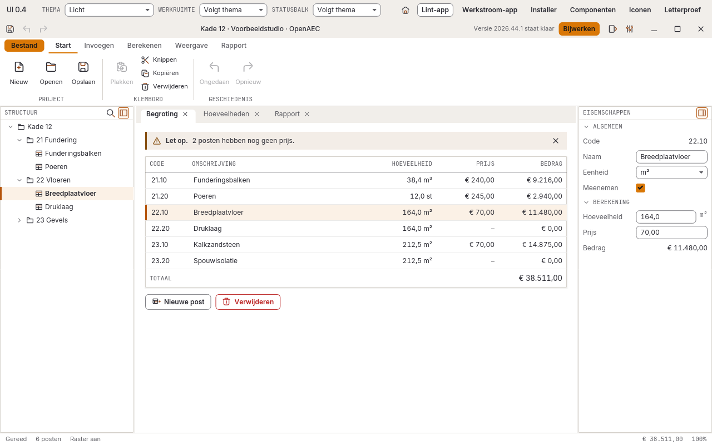

# OpenAEC Blueprint

De blauwdruk voor elke OpenAEC-tool. Wie een tool bouwt of bijwerkt, begint hier: de standaardapplicatie, de gedeelde vormgeving en iconen, het versieschema, een voorbeeld-README, de afspraken voor onder meer MCP en IFCX, en het plan voor het hele ecosysteem.



*De standaardapplicatie in Rust: lint met Bestand-menu, structuurboom, documenttabs, tabel, eigenschappen en statusbalk. De inhoud is voorbeelddata.*

## De standaardapplicatie

Elke OpenAEC-tool heeft dezelfde schil: titelbalk, lint of werkstroom, documenttabs, zijpanelen, statusbalk, instellingen en vijf thema's. Die schil is er in twee uitvoeringen.

| Uitvoering | Staat nu | Starten |
| --- | --- | --- |
| **Tauri** (Tauri 2 + React + TypeScript) | In het [Style Book](https://github.com/OpenAEC-Foundation/OpenAEC-style-book/tree/main/project-templates/Tauri%2BReact); PR #32 haalt het hierheen | zie de README van de template |
| **Rust** (iced, bibliotheek 0.4) | In deze repository, als galerij `ui04` | `cargo run --release --features gpu --bin ui04` |

De galerij toont een lint-app (startscherm, Bestand-scherm, instellingen) en een werkstroom-app (zijbalk of stappen). Andere weergaven: `ui04 -- installer`, `ui04 -- iconen` en `ui04 -- letterproef`.

**Volgorde ([#37](https://github.com/OpenAEC-Foundation/OpenAEC-Blueprint/issues/37)):** eerst de Tauri-applicatie helemaal goed, daarna dezelfde lege applicatie in Rust. Elk krijgt een ondertekende release. Een online versie om in de browser te bekijken, met een 3D-weergave, staat in [#36](https://github.com/OpenAEC-Foundation/OpenAEC-Blueprint/issues/36).

## Wat hier staat

| Onderdeel | Waar |
| --- | --- |
| UI-bibliotheek voor Rust | [`crates/openaec-ui`](crates/openaec-ui/) |
| Alle 945 iconen (16 en 24 px), per app te kiezen | [`crates/openaec-icons`](crates/openaec-icons/) |
| C-bibliotheek met tokens en iconen voor elke taal (.dll, .dylib, .so) | [`crates/openaec-blueprint-sdk`](crates/openaec-blueprint-sdk/) |
| Kleuren, maten en lettertypen (één bron) | [`design/ontwerp-0.4/tokens-0.4.json`](design/ontwerp-0.4/tokens-0.4.json) |
| Webpakket: CSS, fonts en iconen per app | [`web/`](web/) |
| Ontwerp 0.4: fundament, componenten, tegels, layouts | [`design/ontwerp-0.4/`](design/ontwerp-0.4/README.md) |
| Voorbeeld-README voor een tool | [`templates/README-tool.md`](templates/README-tool.md) |
| Plan voor de harmonisatie van alle apps | [`STAPPENPLAN.md`](STAPPENPLAN.md) |
| Overzicht van de apps | [`APP-OVERZICHT.md`](APP-OVERZICHT.md) |
| Alle reviews en onderzoeken tot nu toe | [`UI-HARMONISATIE.md`](UI-HARMONISATIE.md) |

Nog toe te voegen: de afspraken voor MCP-servers en IFCX, en het overkoepelende ecosysteemplan met planning. Codeafspraken en de gedeelde issue-workflow blijven in [`conventions`](https://github.com/OpenAEC-Foundation/conventions), omdat andere repositories daar rechtstreeks naar verwijzen.

## Versienummers

Alle OpenAEC-tools gebruiken **jaar.week**: `JJJJ.W.N`. Dat is het jaar, het ISO-weeknummer zonder voorloopnul en een volgnummer binnen de week dat bij 0 begint.

| Voorbeeld | Betekenis |
| --- | --- |
| `2026.44.0` | eerste release in week 44 van 2026 |
| `2026.44.1` | tweede release in dezelfde week |
| `2026.45.0` | eerste release van de week erna |
| `v2026.44.0` | de bijbehorende Git-tag en GitHub-release |

Punten, geen streepje: `2026-44` is in npm, Cargo en Tauri geen geldige versie. Zie [#1](https://github.com/OpenAEC-Foundation/OpenAEC-Blueprint/issues/1). Alle crates in deze repository staan op hetzelfde nummer; de releaseworkflow weigert een tag die daar niet mee overeenkomt.

## Releases en ondertekening

Een OpenAEC-release bevat de applicatie voor Windows, macOS en Linux, een bibliotheek (.dll, .dylib, .so), `SHA256SUMS` en releasenotes. Alles wordt pas gepubliceerd als de tests slagen, en alles wordt ondertekend: Windows met Authenticode, macOS met een Developer ID en notarisatie door Apple, Linux met de OpenAEC OpenPGP-sleutel en een build-attestatie. Een tag `vJJJJ.W.N` start [`.github/workflows/release.yml`](.github/workflows/release.yml): eerst alle controles en tests, dan de builds en handtekeningen per platform, dan de release. Ontbreekt een sleutel, dan staat dat per bestand in de releasenotes en wordt het een pre-release. De verpakking staat in [`packaging/`](packaging/). Open Pointcloud Studio was het voorbeeld; zie ook [#37](https://github.com/OpenAEC-Foundation/OpenAEC-Blueprint/issues/37).

## Bouwen en controleren

```bash
cargo run --bin style_repo
cargo run --release --features gpu --bin ui04
cargo test
```

De volledige lijst met controles staat in [`AGENTS.md`](AGENTS.md#controles). Draai na een wijziging de controles die bij dat deel horen.

## Samenwerken

- Afspraken voor mensen en AI-assistenten: [`AGENTS.md`](AGENTS.md). Begin elke taak met [`NOTES.md`](NOTES.md).
- Open werk staat als [issue op GitHub](https://github.com/OpenAEC-Foundation/OpenAEC-Blueprint/issues).
- Pushen gaat via GitHub Desktop: **File → Add Local Repository**, kies deze map, en daarna **Push origin**.

Tot 26 oktober 2026 heette deze repository **OpenAEC-Style-Repo**. GitHub stuurt oude links door.

## Licentie

De UI-bibliotheek valt onder LGPL-3.0-only, met eigen licenties voor de lettertypen en enkele vectoren; zie [`crates/openaec-ui/NOTICE.md`](crates/openaec-ui/NOTICE.md). De rest van deze repository valt onder [`LICENSE`](LICENSE). De licentie van de B2-iconen is nog open ([#15](https://github.com/OpenAEC-Foundation/OpenAEC-Blueprint/issues/15)).
