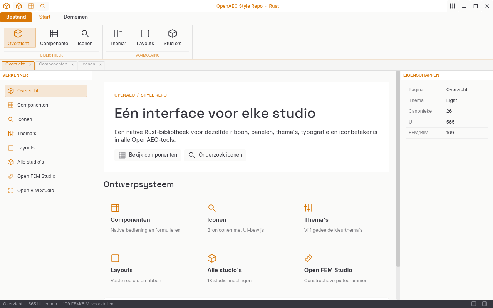

# OpenAEC UI-harmonisatie

Deze repository bevat een volledig in Rust getekende desktop-Style Repo en de afzonderlijk te verpakken [`openaec-ui`-crate](crates/openaec-ui/). De native interface gebruikt `iced` en volgt de regio's, maten, thema's en typografie van de OpenAEC Tauri-template: titelbalk, optionele ribbon of werkstroomnavigatie, documenttabs, werkgebied, status en instellingen. Er is geen React, JavaScript, WebView of Tauri-runtime nodig.

Start de Style Repo met:

```bash
cargo run --bin style_repo
```

De map is een zelfstandige Git-repository op branch `main`, met lokale commits en een schone werkboom. In GitHub Desktop kan hij via **File → Add Local Repository** worden toegevoegd met pad `/home/aia04/Documenten/GitHub/OpenAEC-app-kopie`; daarna maakt **Publish repository** de eerste GitHub-remote aan. Er is nog geen remote ingesteld, dus een gewone Push-knop verschijnt pas na publiceren of koppelen aan een bestaande lege repository.

De app laat componenten, vijf thema's, de gedeelde layout, 18 studio-indelingen met elk negen selecteerbare voorbeeldschermen, 565 onderzochte UI-iconbestanden en 109 getekende FEM/BIM-iconconcepten zien. De broniconen en domeinconcepten zijn bedoeld voor beoordeling; de 27 iconen in [`crates/openaec-ui/assets/icons/`](crates/openaec-ui/assets/icons/) vormen de huidige semantische kern van de crate. De gelijkgehouden kopie in `assets/icons/` bedient de HTML-review. Thema, taal, schaal en paneelinstellingen worden opgeslagen in de gebruikersconfiguratie.



De native studio-atlas toont de voorgestelde tabs en groepen in de echte Rust-ribbon; Energy gebruikt een afzonderlijke werkstroommodus zonder ribbon. Hij is in alle vijf thema's gerenderd: [Light](design/style-repo-atlas-light.png), [Forge](design/style-repo-atlas-forge.png), [OpenAEC](design/style-repo-atlas-openaec.png), [Blueprint](design/style-repo-atlas-blueprint.png) en [High contrast](design/style-repo-atlas-contrast.png). De native Energy-werkstroom toont nieuwbouw in [Light](design/style-repo-energy-workflow-light.png), [Forge](design/style-repo-energy-workflow-forge.png) en [utiliteit](design/style-repo-energy-workflow-utility-light.png), plus bestaande bouw voor [woning](design/style-repo-energy-workflow-existing-light.png) en [utiliteit](design/style-repo-energy-workflow-existing-utility-forge.png). De [FEM-Geometrie-ribbon](design/style-repo-fem-ribbon-light.png) en [BIM-Modelleren-ribbon](design/style-repo-bim-ribbon-forge.png) tonen de native concept-SVG's. De 109 domeiniconen blijven app-eigen reviewmateriaal en maken geen deel uit van de publieke `Icon::ALL`-set. Deze beelden zijn reproduceerbaar met `cargo test --bin style_repo render_tests::export_native_style_repo_previews -- --ignored`.
De [Planner-ribbon](design/style-repo-planner-ribbon-light.png) is aan de actuele bronregistry gespiegeld: de tabs, groepen en gedeelde acties zijn gecontroleerd; overige Lucide-vormen blijven broniconen ter review. De optionele AI-tab en de horizontale ribbon-scroll zijn zichtbaar.

De [PDF-contexttab Afbeelding](design/style-repo-pdf-image-forge.png) toont de echte bronacties en twee gedeelde 0–200%-sliders. De vijf bijbehorende UI-SVG’s staan als bronvormen en thematisch getinte reviewkopieën apart van de canonieke iconenset.
De [PDF-contexttab Schikken](design/style-repo-pdf-arrange-forge.png) toont zes brongroepen, 26 acties en de tweekeuze-instelling ‘Uitlijnen op’ in dezelfde native ribbon. De [icoonbeoordeling](design/pdf-arrange-icon-review.html) vergelijkt alle 24 werkelijk gebruikte inline bronvormen met de donkere reviewversie op 16, 24 en 32 px. De drie Grootte-acties delen nog één bronvorm; hun commando's en de overige PDF-bewerkingen zijn selecteerbare previews, zonder PDF-documentbewerking.
De [HTML-layoutstudie voor PDF Opmaak](design/pdf-format-layout-review.html) inventariseert alle galerijtegels, kleurregelaars, formulierwaarden en contextuele toestanden op basis van de Solid-bron. De [native Opmaak-review in Forge](design/style-repo-pdf-format-forge.png) en [Light](design/style-repo-pdf-format-light.png) gebruikt een [compacte achttegelstrook met een native Meer-popup voor alle tien stijlen en gestippelde randen voor de drie bewolkte stijlen](design/style-repo-pdf-format-gallery-forge.png), de 42 bronkleuren en compacte formulierregels voor lijn, dekking en pijlpunten, inclusief een bewerkbare dekkingswaarde. Een [afzonderlijke render](design/style-repo-pdf-format-symbol-forge.png) toont de Symbooltype-groep die alleen bij één symboolstempel verschijnt. De vijf vaste UI-SVG’s zijn [op 16/24/32 px beoordeeld](design/pdf-format-icon-review.html); vul- en lijnkleur worden dynamisch getoond. De selectie en waarden werken in de atlas, maar schrijven nog niet naar een PDF-document.
Het [interactieve native 7×6-kleurraster](design/style-repo-pdf-format-palette-forge.png) staat in de PDF-atlas als gedeeld Rust-component en opent ook als [echte ribbonpopup](design/style-repo-pdf-format-popup-forge.png). Een pixeltest controleert alle 42 bronkleuren in hun oorspronkelijke kolomvolgorde; een interactietest controleert kleurkeuze en sluiten bij een klik erbuiten. De bronoptie ‘Geen’ voor vulling en een [native hexkleurveld](design/style-repo-pdf-format-custom-forge.png) werken; het Solid-bronvenster gebruikt hiervoor een OS-kleurkiezer, dus dit invoerpad is functioneel maar niet pixelidentiek.
De [Calc-ribbon](design/style-repo-calc-ribbon-light.png) volgt de echte linttabs en commandogroepen op broncommit b470427; de Nederlandse begroting en het rapport zijn als aparte referenties in de review opgenomen. De tafelinhoud in de atlas is nog een stijlproef.

De [Geotechniek-ribbon](design/style-repo-geotech-ribbon-light.png) volgt de kern- en extensietabs van de actuele bron. Kaart, sonderingsgrafiek en boorprofiel staan als afzonderlijke schermreferenties in de review.

De [Heatloss-ribbon](design/style-repo-heatloss-ribbon-light.png) gebruikt de actuele route-tabs; zijn IFC-lint is bewust leeg. Voor deze app ontbreken nog echte schermcaptures.

De [Calculations-ribbon](design/style-repo-calculations-ribbon-light.png) volgt de twee huidige tabs; zijn IFC-lint is bewust leeg. Ook hier zijn nog geen echte schermcaptures beschikbaar.

De [Reports-ribbon](design/style-repo-reports-ribbon-light.png) volgt de actuele Start-, Invoegen- en Beeld-groepen; echte schermcaptures ontbreken nog in deze bron.

De [BIM Validator-ribbon](design/style-repo-validator-ribbon-light.png) toont de brongecontroleerde Start- en Beeldgroepen in de niet-verbonden BCF-staat.

De [Pile Plan-ribbon in Forge](design/style-repo-pile-ribbon-forge.png) volgt Plan en Weergave. De [native Weergave-review](design/style-repo-pile-view-forge.png) toont nu een werkende 10–200%-symboolslider, begrensde benuttingskeuze en voorgrondknoppen; de HTML-review en drie echte broncaptures blijven de referentie voor vorm en schermindeling.

De Frame-ribbon toont [Sjabloon](design/style-repo-frame-ribbon-light.png), [IFC LOD](design/style-repo-frame-ifc-light.png) en [Thema](design/style-repo-frame-view-light.png) nu als gedeelde native keuzelijsten met de brongepinde opties en beginwaarden.

De native iconenpagina toont de 27 canonieke Rust-iconen en vier afzonderlijke, beoordeelde CAD/Pointcloud-domeinbetekenissen met eigen 16 px-vormen, los van de 565 onderzoeksbronnen: [Light](design/style-repo-icons-light.png) en [Forge](design/style-repo-icons-forge.png).
De [componentenpagina in Light](design/style-repo-components-light.png) en [Forge](design/style-repo-components-forge.png) toont de gedeelde primaire, secundaire en uitgeschakelde knoppen, plus een werkende checkbox en slider. Pointcloud tekent ook zijn scrollbalken, tooltips en voortgangsbalken met de stijlfuncties uit dezelfde crate.
De [instellingenreview](design/settings-modal-review.html) vergelijkt de gepinde Tauri-bron met Style Repo en Pointcloud in Light en Forge. Modal, tabbladen, themakiezer en resetbevestiging komen uit dezelfde Rust-crate. Beide apps tonen themawijzigingen als preview; Annuleren herstelt de oorspronkelijke waarden en Opslaan schrijft ze weg. De overige instellingen blijven van de betreffende app.
De [algemene modalreview](design/dialog-modal-review.html) toont de 480 px gedeelde Rust-modal in de Style Repo en in Pointcloud's echte 2D-tekeningvenster. De crate beheert de vensterbrede overlay, rechte rand, 30 px kop en 44 px voet; de apps leveren formulier en acties. De Style Repo kan de dialoog vanuit de componentenpagina openen en met Escape sluiten.

Een andere Rust-tool kan de shell via de `Application`-trait gebruiken. [`examples/studio.rs`](examples/studio.rs) is een klein integratievoorbeeld (`cargo run --example studio`).
Voor bestaande native applicaties met een eigen eventloop biedt [`crates/openaec-ui/src/frame.rs`](crates/openaec-ui/src/frame.rs) dezelfde buitenste bandindeling via `FrameSlots`; Pointcloud Studio gebruikt die adapter voor het volledige venster en behoudt zijn eigen 3D-canvas en commando's.

Open [`design/review.html`](design/review.html) in een browser voor het interactieve overzicht. De 565 via UI-broncode of actieve knopbundels onderbouwde iconbestanden staan in `harmonization/ui-icons/`. Daarnaast zijn 312 geïmporteerde Lucide- en Solid/Tabler-SVG's uit de gebruikte pakketversies bewaard en op light/dark te bekijken in [`design/library-icons.html`](design/library-icons.html). Die vormen blijven een aparte onderzoekscategorie. De [UI-icoonreviewwerkbank](design/icon-review-board.html) toont alle 565 bewezen UI-bestanden op licht en donker in 16/24/32 px en kan lokale ontwerpbesluiten als JSON exporteren. Het [semantische kruisverband](design/icon-semantic-crosswalk.html) koppelt beide categorieën als reviewkandidaten aan de 26 gedeelde iconbetekenissen en toont alle overige broniconen apart. Zes extra broniconen maken de vergelijking in [`design/icon-comparison.html`](design/icon-comparison.html) compleet. De volledige index van 666 gevonden schermbeeldkandidaten, waaronder 145 van Planner Studio, staat in [`design/screen-inventory.html`](design/screen-inventory.html); een gedeelde shell voor 18 studio's, met brongetrouwe Speech-zijbalk en negen gedeelde schermtoestanden voor de 16 overige studio's in [`design/harmonized.html`](design/harmonized.html). De 109 uitgewerkte FEM/BIM-vectorconcepten staan in [`design/domain-icon-atlas.html`](design/domain-icon-atlas.html); tien daarvan hebben ook een vereenvoudigde 16 px-versie. De [FEM/BIM-bronvergelijking](design/domain-candidate-review.html) toont de 54 naamkandidaten bij 24 concepten, met een voorlopig oordeel en direct UI-codebewijs per bronicoon. De concepten zijn in de FEM- en BIM-ribbons geplaatst, maar blijven buiten de publieke icon-API tot de semantische en kleine-maatbeoordeling klaar is. De [Energy-werkstroomreview](design/energy-workflow.html) vergelijkt de actuele routevarianten met een brongepind projectbeeld. De expliciete beoordeling en openstaande ontwerpstappen staan in [`design/assessment.md`](design/assessment.md). Het volledige bronarchief van circa 27.000 visuele bestanden blijft lokaal in `harmonization/sources/` en staat bewust buiten Git; de metadata en herkomst staan in `harmonization/asset-index.json`.

De [naamgenotenreview](design/icon-name-review.html) zet 189 iconvarianten uit 80 tooloverstijgende naamgroepen naast elkaar met links naar hun gebruik in broncode. Alle 80 groepen zijn op hun gebruikscontext beoordeeld. Namen als Download, Copy en Scale blijken verschillende handelingen te dekken, dus de bijbehorende vormen zijn nog geen gedeelde Rust-iconen.

De bibliotheekiconen zijn verder op werkelijk broncodegebruik gecontroleerd: 608 van de 686 importvoorkomens verschijnen rechtstreeks als JSX-component, 78 worden na de import als identifier gebruikt. De review onderscheidt 287 direct gebruikte SVG-varianten van 25 varianten die alleen indirect worden doorgegeven, met een link naar de gebruiksregel op de vastgelegde broncommit. Dit blijft statisch codebewijs; zichtbaarheid hangt af van de applicatietoestand.

De [Field Studio-schermroute-review](design/field-route-review.html) zet tien actuele navigatieroutes naast zes bewaarde bronbeelden en koppelt elke route aan de exacte UI-code. Vier routes hebben alleen codebewijs. Het [Project-formulier is nu ook native in Rust opgebouwd](design/style-repo-field-topnav-light.png) met gedeelde, bewerkbare formuliervelden; BAG, energielabel en opslag zijn reviewacties.

Alle 666 gevonden screenshotkandidaten zijn rechtstreeks uit hun vastgelegde Git-commit gerenderd op [47 schermcontactbladen](design/screen-contact-sheets.html). Het overzicht toont de 472 als applicatiescherm ingedeelde beelden naast handleidingbeelden, mockups, tutorialuitsneden en websitebeelden; historische captures worden niet als bewijs voor de actuele UI behandeld. De [volledige bronindex](design/screen-inventory.html) blijft per bestand doorzoekbaar.

De vijf vaste vensterbanden, 24 px-paneelwerkbalken en de standaardbreedte van beide zijpanelen zijn vastgelegd in [`design/layout-spec.json`](design/layout-spec.json) met een exacte Tauri-broncommit. `python3 scripts/check_layout_metrics.py` vergelijkt de Rust-crate en het HTML-prototype met die maten, en met de lokale Tauri-bron wanneer die naast deze repo staat.
`python3 scripts/check_icon_adoptions.py` controleert de zes iconbesluiten en identieke SVG-inhoud in de lokale Pointcloud-integratie.
`python3 scripts/check_portable_ui.py` vergelijkt de volledige portable crate met deze bron: Rust-code na formattering, alle 28 gebundelde fonts/iconen en de runtime-dependencies.
`python3 scripts/check_crate_package.py` controleert de pakketgrens en `cargo package -p openaec-ui` bouwt de zelfstandige crate uit het verpakte archief. Het pakket bevat de 27 canonieke bedieningsiconen en vier beoordeelde domeinbetekenissen met aparte 16 px-vectoren, naast de Rust-bronnen, zes fonts en drie OFL-licentieteksten. De Style Repo-app staat als afzonderlijk, niet-publiceerbaar Cargo-package in dezelfde workspace. De 565 onderzoeksiconen, FEM/BIM-concepten en reviewbeelden gaan niet mee in het `openaec-ui`-pakket. Voor gebruik in een andere Git-checkout kan de crate via een Git-dependency of een lokale path-dependency worden toegevoegd; er is nog geen remote voor deze repository ingesteld.

De eerste productintegratie staat in de lokale `open-pointcloud-studio`-checkout op branch `feat/shared-rust-ui`. Daar draait een portable snapshot van deze crate als `native/ui`; de Pointcloud-titelbalk, [tien algemene toolacties, twee domeinacties en de Extensions-bestandspagina](design/icon-adoptions.json) gebruiken de gedeelde iconen, naast de gebundelde lettertypen, knoppen, invoervelden, keuzelijsten, checkboxen, sliders, voortgangsbalken, scrollbalken, tooltips en 77 gedeelde Tauri-kleurvelden per thema. De stevige randkleur voor sliders en voortgangsbalken komt aanvullend uit de vastgelegde Style Book-merktokens. De [Extensions-iconreview](design/extensions-icon-review.html) onderbouwt waarom die pagina een puzzelstuk krijgt in plaats van een 3D-kubus. De vier beoordeelde navigatie-iconen staan in de [Light/Forge-review](design/navigation-icon-review.html); de nieuwe 3D BAG- en EDL-vormen staan op 16, 24 en 32 px in de [botsingsreview](design/icon-collision-review.html). De overige domeinribbon en panelen worden na de visuele en semantische beoordeling verder overgezet.

De [documentbalkreview](design/document-bar-review.html) zet de gepinde Tauri-CSS en de native Light- en Forge-renders naast elkaar. De gedeelde Rust-crate tekent nu de 30 px-band én de 24 px-tabstijl in Style Repo en Pointcloud; vier echte Pointcloud-tabs tonen de integratie. De gedeelde tab maskeert nu ook Iced’s onderste rand van 2 px zoals in de Tauri-CSS; de Pointcloud-pixeltest controleert dit in Light en Forge. De review benoemt de contrastverbetering van de actieve sluitknop.

De [ribbon-groepsreview](design/ribbon-group-review.html) vergelijkt de Tauri-`Ribbon.css` met native Pointcloud- en Style Repo-renders. `widgets::ribbon_group` tekent in beide applicaties dezelfde 94 px-groep, 4 px bovenruimte, 8 px zijruimte, labelregel en rechter scheidslijn. Pointcloud behoudt zijn adaptieve inklapgedrag; de Style Repo toont de groepslabels boven een smalle horizontale scrollbar.

De [eigenschappenreview](design/property-grid-review.html) toont de rechterpanelen van beide native applicaties in Light en Forge. De gedeelde Rust-crate tekent daar 28 px label/waarde- en bedieningsrijen en 24 px sectiekoppen. De Style Repo toont een werkende schaalregelaar in dit raster; Pointcloud gebruikt het voor zes snedebox-regelaars en de bewerkbare viewportvelden. De domeinwaarden en berichten blijven van de betreffende applicatie.

De [icoonbotsingreview](design/icon-collision-review.html) beoordeelt alle 14 paren met exact dezelfde bronbytes. Acht paren koppelen de vorm aan verschillende handelingen; daarvoor staan 16 onderscheidende vectoren in 16/24/32 px op licht en donker. Zes Bouwkunde-paren hergebruiken de vorm voor verwante handelingen bij deur- en kozijnstaten. Vier CAD/Pointcloud-vormen zijn in `DomainIcon` opgenomen; Pointcloud gebruikt er twee. De overige twaalf blijven concepten buiten de publieke Rust-icoon-API.

## Via GitHub Desktop publiceren

1. Kies **File → Add local repository** en selecteer deze map: `/home/aia04/Documenten/GitHub/OpenAEC-app-kopie`.
2. De lokale startcommit staat al klaar. Kies **Publish repository** in GitHub Desktop.
3. Kies de gewenste eigenaar, repositorynaam en zichtbaarheid. Controleer die keuzes en publiceer.

Latere wijzigingen kun je in GitHub Desktop committen en met **Push origin** versturen. De Git-geschiedenis begint lokaal; er is nog geen GitHub-remote ingesteld. De bestaande repository `OpenAEC-style-book` wordt hierdoor niet gewijzigd.

De lokale map `harmonization/sources/` en Rust-buildmap `target/` staan in `.gitignore`, zodat ze niet per ongeluk meegepusht worden. Controleer licenties van bronassets vóór definitief gebruik in een gedeelde crate.
