[English](README.md) · **Nederlands**

<div align="center">

# OpenAEC Blueprint

**De blauwdruk voor elke OpenAEC-tool. Eén standaardapplicatie in Tauri, Rust en de browser, met gedeelde ontwerptokens, lettertypen, 945 iconen, een versieschema en ondertekende releases.**

[](https://github.com/OpenAEC-Foundation/OpenAEC-Blueprint/releases/latest)
[](https://github.com/OpenAEC-Foundation/OpenAEC-Blueprint/actions/workflows/release.yml)
[](crates/openaec-icons/)
[](design/ontwerp-0.4/tokens-0.4.json)
[](#licentie)

### [Probeer in de browser](https://openaec-foundation.github.io/OpenAEC-Blueprint/) &nbsp;·&nbsp; [Download](https://github.com/OpenAEC-Foundation/OpenAEC-Blueprint/releases/latest) &nbsp;·&nbsp; [README-sjabloon](templates/README-tool.md)

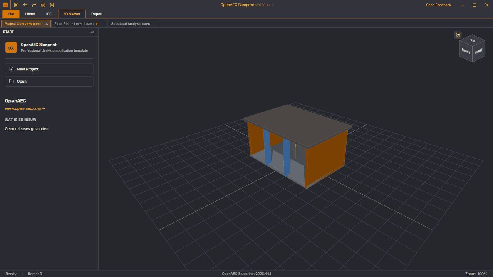

</div>

OpenAEC Blueprint is waar elke OpenAEC-tool begint. Hier staan de lege standaardapplicatie waarop elke tool voortbouwt, de gedeelde vormgeving (kleuren, maten, lettertypen en iconen), het versieschema en de releaseworkflow die alles ondertekent. Een tool die de blauwdruk volgt, ziet er vanaf de eerste build uit en gedraagt zich zoals de andere OpenAEC-tools.

De standaardapplicatie is er in drie vormen: een Tauri-app met React, een native Rust-app, en de Tauri-app als webpagina die je niet hoeft te installeren.

## Probeer het

**[Open de browserversie](https://openaec-foundation.github.io/OpenAEC-Blueprint/)**. Dat is de Tauri-standaardapplicatie, gebouwd als webapp: lint, documenttabs, zijpanelen, instellingen met vijf thema's en een 3D-weergave met ViewCube. Je thema blijft staan na herladen.

De Rust-versie draait op je eigen computer: download hem hieronder, of bouw hem met `cargo run --bin blueprint`.

## Downloaden

Elke release staat op de [releasepagina](https://github.com/OpenAEC-Foundation/OpenAEC-Blueprint/releases/latest).

| Platform | Standaardapplicatie | Bibliotheek voor andere talen |
|----------|---------------------|-------------------------------|
| **Windows** | `.exe`-installer (x64), `.zip` | `.dll` in `openaec-blueprint-sdk_…_windows-x64.zip` |
| **macOS** | `.dmg` (universeel: Apple silicon en Intel) | `.dylib` in `openaec-blueprint-sdk_…_macos-universal.tar.gz` |
| **Linux** | `.deb`, `.rpm`, `.AppImage`, `.tar.gz` | `.so` in `openaec-blueprint-sdk_…_linux-x64.tar.gz` |

Elk bestand is ondertekend: Windows met Authenticode, macOS met een Developer ID en notarisatie door Apple, Linux met de OpenAEC OpenPGP-sleutel en een build-attestatie. `SHA256SUMS` controleert alle bestanden in één keer.

## Waarom gebruiken?

- **Eén uiterlijk voor alle tools.** Kleuren, maten en lettertypen komen uit één bestand, [`tokens-0.4.json`](design/ontwerp-0.4/tokens-0.4.json). Rust, CSS en de C-bibliotheek worden daaruit gegenereerd.
- **Begin met een werkende schil.** Titelbalk, lint of werkstroom, documenttabs, zijpanelen, statusbalk en instellingen staan er al. Een tool zet zijn eigen werk in het midden.
- **Gedrag dat je niet opnieuw bouwt.** Opslaan en sluiten via één sluitplan (ook bij Alt+F4), ongedaan maken per document, de bijwerkmelding, eigen sneltoetsen en een toegankelijke naam voor elk onderdeel.
- **Vijf thema's.** Licht, Donker, Blueprint, Hoog contrast donker en Hoog contrast licht, in elke vorm van de applicatie.
- **945 iconen** in 16 en 24 px, één stijl voor elke tool. Een tool neemt alleen de iconen op die hij gebruikt.
- **Elke programmeertaal.** Een C-bibliotheek (`.dll`, `.dylib`, `.so`) geeft tokens en iconen aan tools die niet in Rust zijn geschreven.
- **Releases die gecontroleerd en ondertekend zijn.** Eén tag start de controles, de builds voor drie systemen, de handtekeningen en de release.

## Schermafbeeldingen

| | |
|---|---|
| 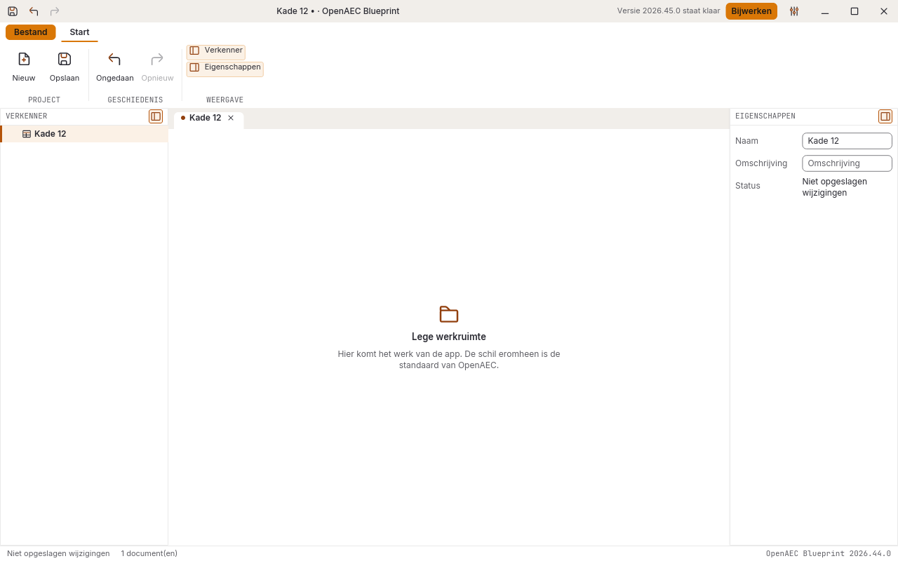 **De Rust-standaardapplicatie** | 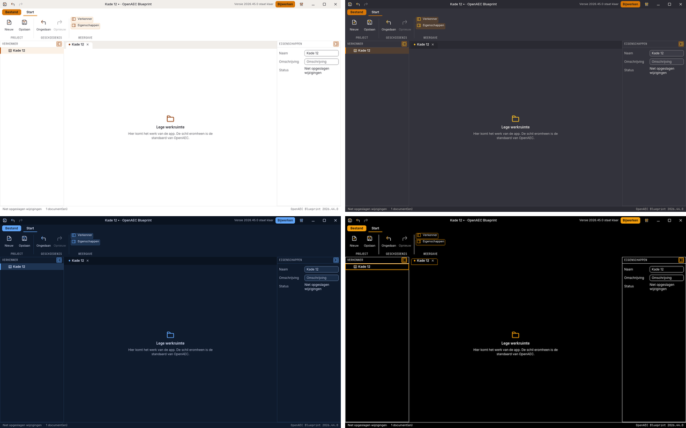 **Licht, Donker, Blueprint en Hoog contrast donker** |
| 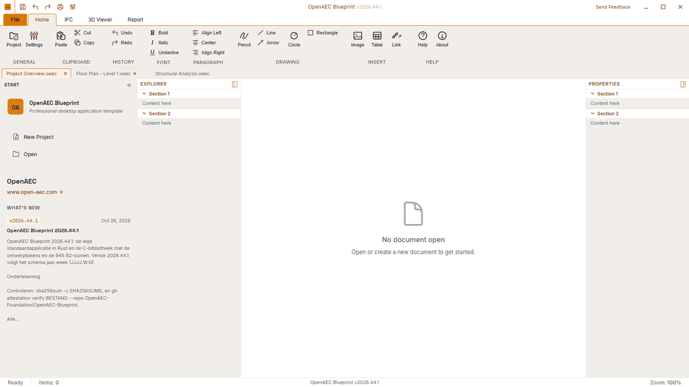 **De Tauri-standaardapplicatie** | 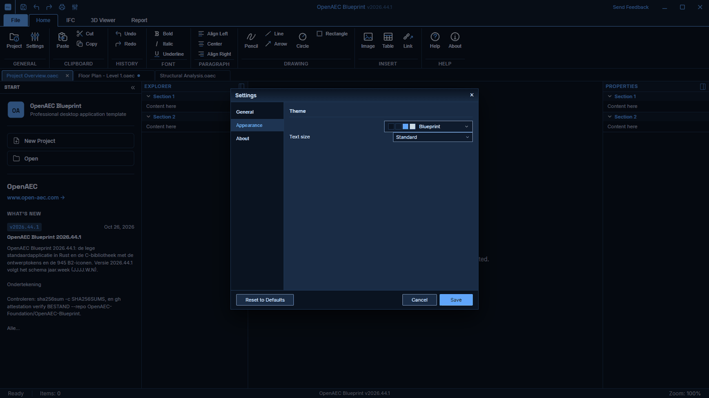 **Instellingen, thema Blueprint** |
| 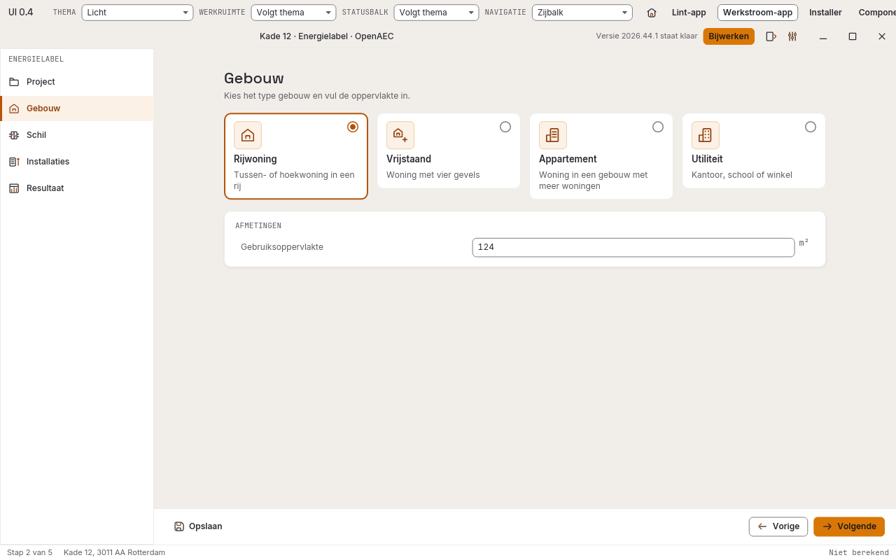 **Een werkstroom-app met stappen in een zijbalk** | 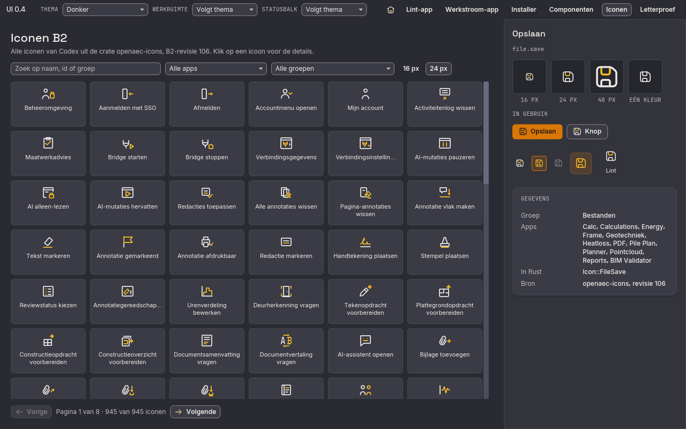 **De iconenbrowser met alle 945 iconen** |
| 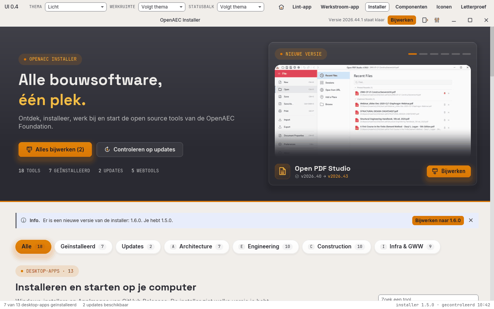 **De OpenAEC Installer in dezelfde stijl** | |

De Rust-schermen zijn in het Nederlands, de taal van de voorbeelddata. De browserschermen zijn in het Engels.

## De standaardapplicatie

| Vorm | Waar | Starten |
|------|------|---------|
| **Tauri** (Tauri 2, React, TypeScript) | [`style-book/project-templates/Tauri+React`](style-book/project-templates/Tauri+React/) | zie de README van de sjabloon |
| **Online** (webbuild van de Tauri-app) | [`web/online/`](web/online/README.md), gepubliceerd op GitHub Pages | [openaec-foundation.github.io/OpenAEC-Blueprint](https://openaec-foundation.github.io/OpenAEC-Blueprint/), of lokaal `node web/online/build.mjs --serve` |
| **Rust** (iced, bibliotheek 0.4) | [`src/bin/blueprint.rs`](src/bin/blueprint.rs) | `cargo run --bin blueprint` |

Een Rust-tool neemt `blueprint.rs` over, zet zijn eigen werk in de werkruimte en zijn opdrachten in `commands()`. De galerij `ui04` toont meer voorbeeldschermen: een lint-app, een werkstroom-app, de installer, alle iconen en een letterproef (`cargo run --release --features gpu --bin ui04`).

| | |
|---|---|
| 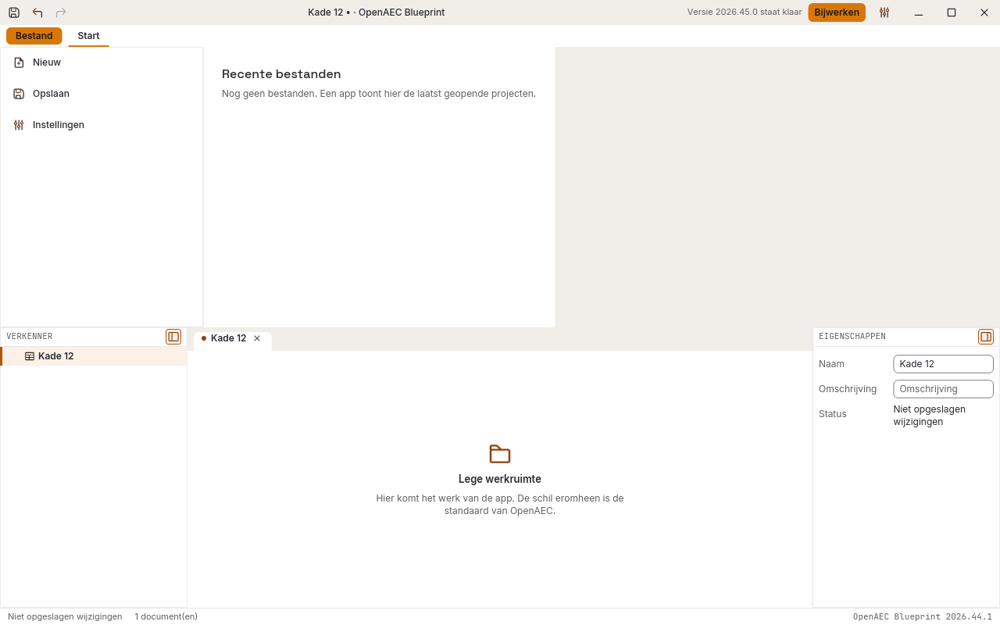 **Bestand-scherm met recente bestanden** | 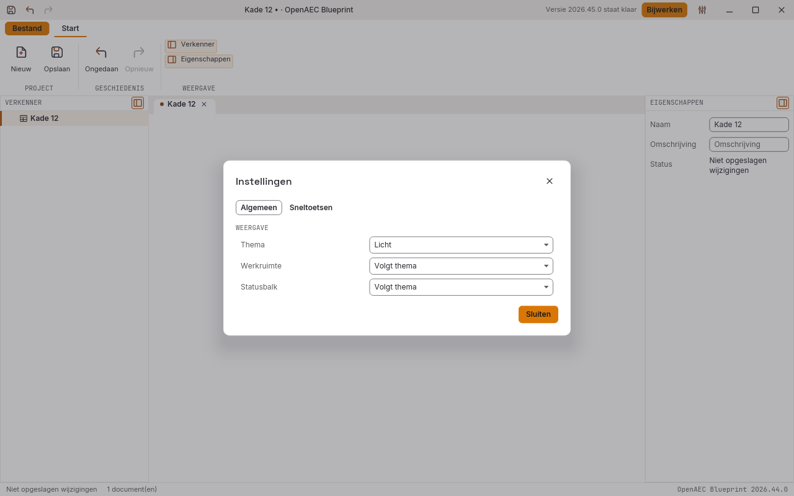 **Instellingen: thema, werkruimte, statusbalk en sneltoetsen** |
| 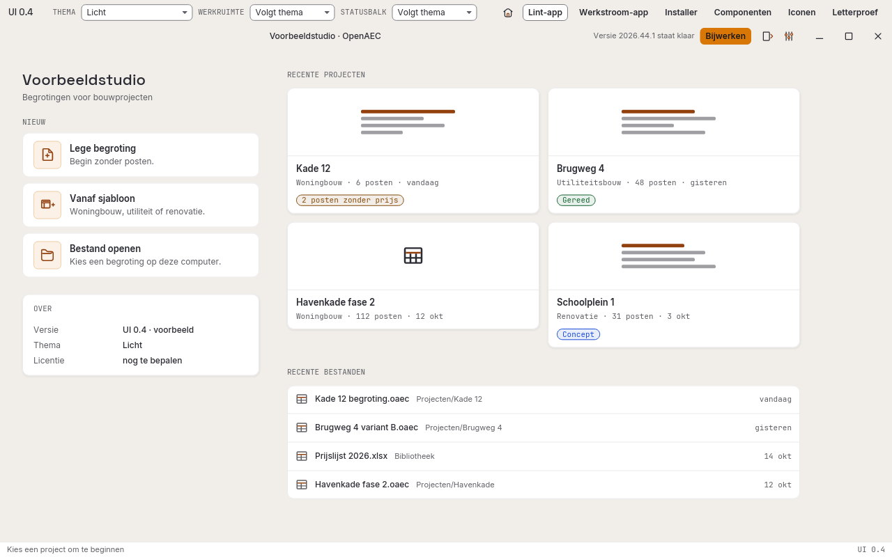 **Startscherm van een lint-app, uit de galerij** | 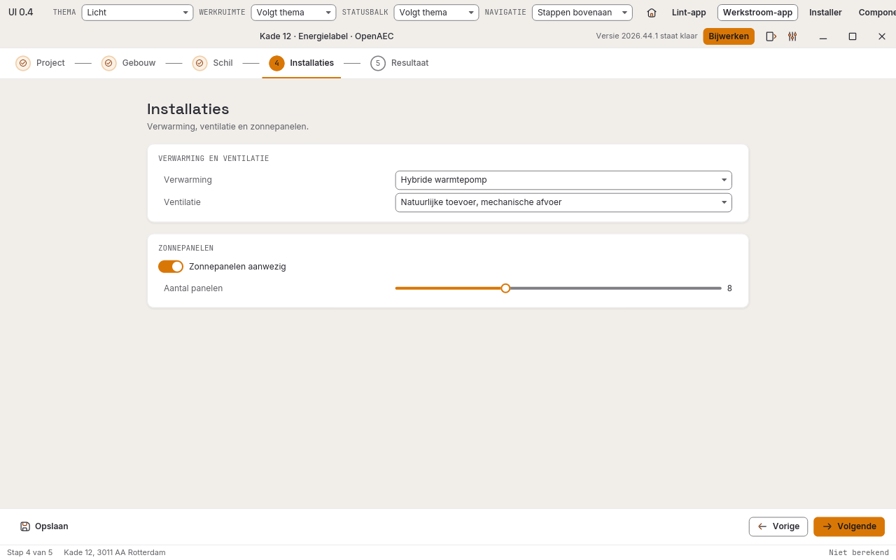 **Werkstroom-app met stappen bovenaan, uit de galerij** |

Eerst komt de Tauri-app, daarna dezelfde lege app in Rust. Elk krijgt een ondertekende release ([#37](https://github.com/OpenAEC-Foundation/OpenAEC-Blueprint/issues/37)). De online versie ([#36](https://github.com/OpenAEC-Foundation/OpenAEC-Blueprint/issues/36)) wordt na elke release opnieuw gepubliceerd.

## Wat hier staat

| Onderdeel | Waar |
|-----------|------|
| UI-bibliotheek voor Rust | [`crates/openaec-ui`](crates/openaec-ui/) |
| Alle 945 iconen (16 en 24 px), per app te kiezen | [`crates/openaec-icons`](crates/openaec-icons/) |
| C-bibliotheek met tokens en iconen voor elke taal | [`crates/openaec-blueprint-sdk`](crates/openaec-blueprint-sdk/) |
| Kleuren, maten en lettertypen (één bron) | [`design/ontwerp-0.4/tokens-0.4.json`](design/ontwerp-0.4/tokens-0.4.json) |
| Webpakket: CSS, fonts en iconen per app | [`web/`](web/) |
| Ontwerp 0.4: fundament, componenten, tegels, layouts | [`design/ontwerp-0.4/`](design/ontwerp-0.4/README.md) |
| README-sjabloon en de README-standaard; sjabloon en standaard voor de app-pagina op open-aec.com | [`templates/`](templates/) |
| Plan voor de harmonisatie van alle apps | [`STAPPENPLAN.md`](STAPPENPLAN.md) |
| Overzicht van de apps | [`APP-OVERZICHT.md`](APP-OVERZICHT.md) |
| Alle reviews en onderzoeken tot nu toe | [`UI-HARMONISATIE.md`](UI-HARMONISATIE.md) |

Codeafspraken en de gedeelde issue-workflow blijven in [`conventions`](https://github.com/OpenAEC-Foundation/conventions), omdat andere repositories ze daar rechtstreeks aanroepen.

## Versienummers

Alle OpenAEC-tools gebruiken **jaar.week**: `JJJJ.W.N`. Dat is het jaar, het ISO-weeknummer zonder voorloopnul en een volgnummer binnen de week dat bij 0 begint.

| Voorbeeld | Betekenis |
|-----------|-----------|
| `2026.44.0` | eerste release in week 44 van 2026 |
| `2026.44.1` | tweede release in dezelfde week |
| `2026.45.0` | eerste release van de week erna |
| `v2026.44.0` | de bijbehorende Git-tag en GitHub-release |

Punten, geen streepje: `2026-44` is in npm, Cargo en Tauri geen geldige versie. Zie [#1](https://github.com/OpenAEC-Foundation/OpenAEC-Blueprint/issues/1). Alle crates in deze repository staan op hetzelfde nummer; de releaseworkflow weigert een tag die daar niet mee overeenkomt. `python scripts/version.py --check` controleert dat lokaal, `--set 2026.44.1` zet een nummer in alle crates, en `--next` kiest het volgende nummer voor vandaag.

## Releases en ondertekening

Een tag `vJJJJ.W.N` start [`release.yml`](.github/workflows/release.yml): eerst alle controles en tests, dan de builds en handtekeningen per platform, dan de release met releasenotes. Ontbreekt een sleutel, dan staat dat per bestand in de releasenotes en wordt het een pre-release. De verpakking staat in [`packaging/`](packaging/). Open Pointcloud Studio was het voorbeeld.

## Testen en betrouwbaarheid

- **Elf repositorycontroles** draaien voor elke release: versie, layoutmaten, icoongebruik, overdraagbare UI, cratepakket, tokens, gegenereerde tokens, iconencrate, webcomponenten, fontpakket en webiconen. Ze zijn de eerste stap van [`release.yml`](.github/workflows/release.yml).
- **Rust-tests** voor de hele workspace, en nog een keer voor de iconencrate met alle iconen aan.
- **Gegenereerde bestanden worden gecontroleerd, niet vertrouwd.** Tokens, iconen, webcomponenten, fonts, de Tauri-sjabloon en deze README-beelden hebben elk een script met `--check` dat faalt als het gecommitte bestand afwijkt van wat de bron zou geven.
- **Schermen worden door de tests gemaakt.** `cargo test --bin blueprint -- --ignored` schrijft de schermen van de Rust-app in vier thema's naar [`design/blueprint/`](design/blueprint/). `node web/online/screenshots.mjs` maakt de schermen van de browserversie.

De volledige lijst met controles staat in [`AGENTS.md`](AGENTS.md#controles).

## Huidige beperkingen

- **De controles draaien bij een release, niet bij elke pull request.** Er is nog geen aparte CI-workflow.
- **De licentie van de B2-iconen is nog open** ([#15](https://github.com/OpenAEC-Foundation/OpenAEC-Blueprint/issues/15)). Controleer die voordat je de iconen in een ander product uitbrengt.
- **De afspraken voor MCP-servers en IFCX zijn nog niet geschreven**, en het ecosysteemplan met planning ook niet.
- **De online versie kan geen rapporten maken of opslaan.** Daarvoor is de Rust-kant van de desktop-app nodig.
- **Sommige namen zeggen nog Style Repo.** Tot 26 oktober 2026 heette deze repository OpenAEC-Style-Repo; de binary `style_repo` en enkele teksten zijn nog niet omgedoopt. GitHub stuurt oude links door.

Iets gevonden? [Maak een issue](https://github.com/OpenAEC-Foundation/OpenAEC-Blueprint/issues).

## Onder de motorkap

De Rust-bibliotheek is gebouwd op [iced](https://iced.rs/) en tekent elk scherm zelf, met dezelfde tokens als het webpakket. De Tauri-sjabloon gebruikt Tauri 2, React en TypeScript, met Three.js voor de 3D-weergave. De online versie bouwt die sjabloon ongewijzigd met Vite en vervangt alleen wat in een browser anders werkt: instellingen in `localStorage`, links in een nieuw tabblad. De C-bibliotheek is een `cdylib` en `staticlib` uit [`openaec-blueprint-sdk`](crates/openaec-blueprint-sdk/), met een header en een C-voorbeeld.

## Bijdragen

- **Meld een probleem of idee** als [issue](https://github.com/OpenAEC-Foundation/OpenAEC-Blueprint/issues). Beschrijf wat je deed, wat je verwachtte en wat er gebeurde.
- **Bouw je een tool?** Begin met de standaardapplicatie en het [README-sjabloon](templates/README-tool.md). De eisen voor een README staan in [`templates/README-standaard.md`](templates/README-standaard.md). De pagina op open-aec.com begint met [`templates/productpagina.html`](templates/productpagina.html), met de eisen in [`templates/productpagina-standaard.md`](templates/productpagina-standaard.md). Een bestaande pagina ombouwen gaat met [`templates/productpagina-ombouwen.md`](templates/productpagina-ombouwen.md); de schermafbeeldingen komen uit [`templates/productpagina-schermen/`](templates/productpagina-schermen/).
- **Werk je in deze repository**, alleen of met een AI-assistent: lees [`AGENTS.md`](AGENTS.md) en begin elke taak met [`NOTES.md`](NOTES.md).

## Snel beginnen (ontwikkelaars)

```bash
git clone https://github.com/OpenAEC-Foundation/OpenAEC-Blueprint.git
cd OpenAEC-Blueprint
cargo run --bin blueprint
cargo test
```

Rust met de MSVC-toolchain op Windows. De scripts in `scripts/` hebben Python 3 nodig. De Tauri-sjabloon en de online versie hebben Node 22 of nieuwer nodig.

OpenAEC Blueprint hoort bij de apps van de [OpenAEC Foundation](https://github.com/OpenAEC-Foundation).

## Licentie

De UI-bibliotheek valt onder LGPL-3.0-only, met eigen licenties voor de lettertypen en enkele vectoren; zie [`crates/openaec-ui/NOTICE.md`](crates/openaec-ui/NOTICE.md). De rest van deze repository valt onder CC BY-SA 4.0, zie [`LICENSE`](LICENSE). De licentie van de B2-iconen is nog open ([#15](https://github.com/OpenAEC-Foundation/OpenAEC-Blueprint/issues/15)).
