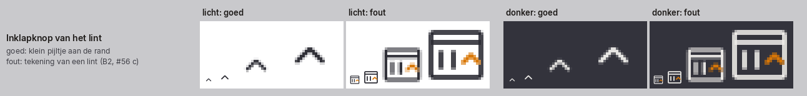
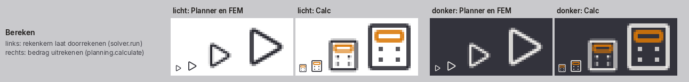
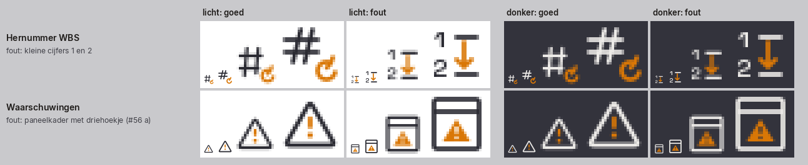
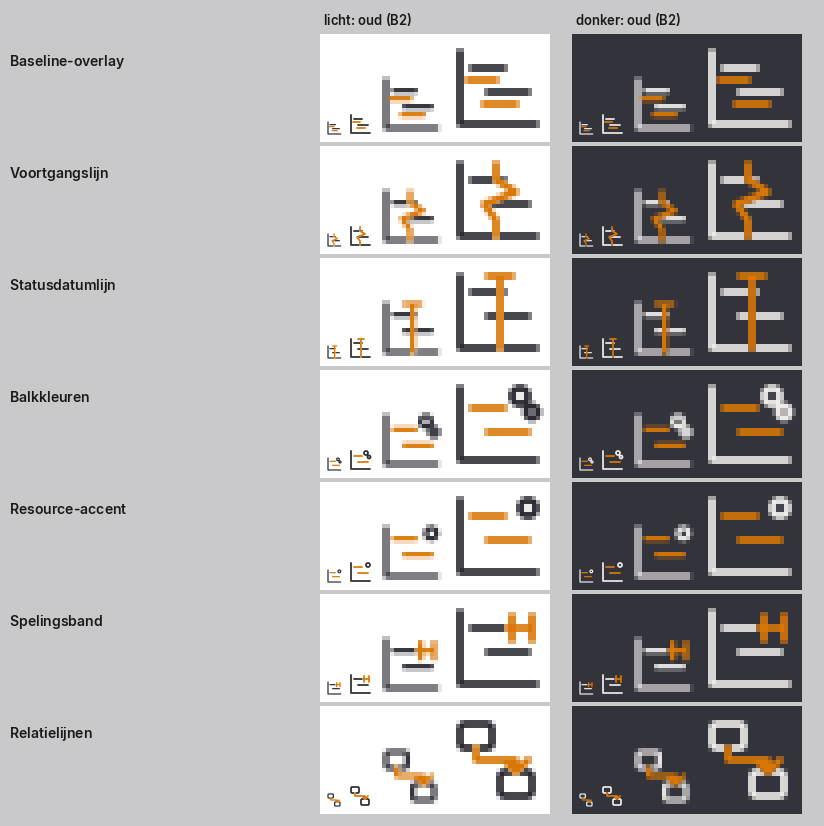
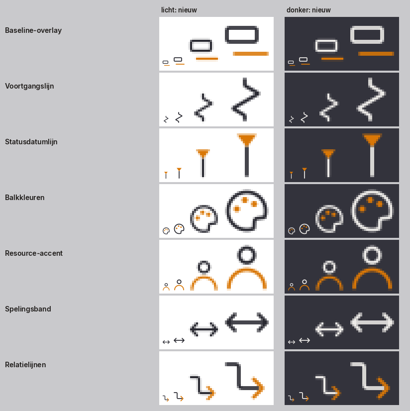
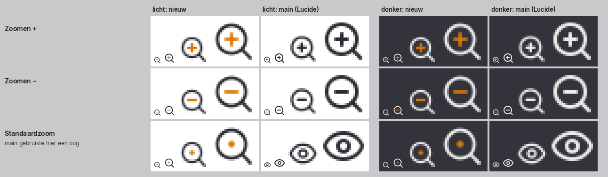
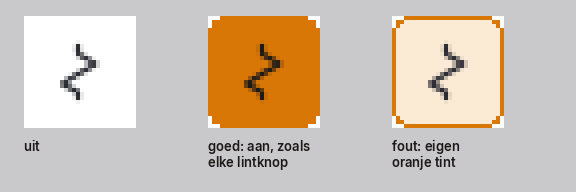
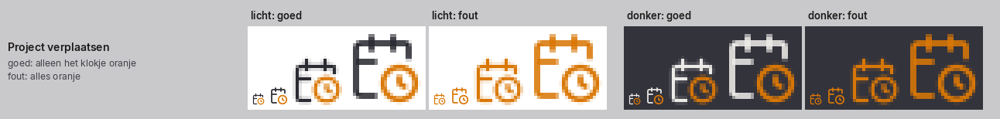

# Iconen in OpenAEC

Deze richtlijn geldt voor elk icoon in de Blueprint en in elk OpenAEC-programma. Ze bepaalt hoe je een icoon kiest, hoe je het tekent en hoe je het controleert.

- **Vastgesteld:** de zes principes en de vaste regels zijn van Ethan, uit een grill op 29 oktober 2026. Ze volgen uit de issues [#56](https://github.com/OpenAEC-Foundation/OpenAEC-Blueprint/issues/56) en [#57](https://github.com/OpenAEC-Foundation/OpenAEC-Blueprint/issues/57).
- **Getoetst:** op 29 oktober 2026 zijn ze naast professionele richtlijnen en onderzoek gelegd. De bronnen bevestigen alle zes; geen enkele bron spreekt een principe tegen. Per principe staat hieronder een citaat.
- **Voorstel:** wat de bronnen toevoegen, staat apart onder [Aanvullingen uit de bronnen](#aanvullingen-uit-de-bronnen-voorstel). Die punten zijn nog niet door Ethan bevestigd.
- **Werkwijze:** de stappen staan in de skill [`.claude/skills/iconen-ontwerpen/SKILL.md`](../.claude/skills/iconen-ontwerpen/SKILL.md).

## In het kort

1. Een icoon laat snel zien waar je klikt. De naam en de tooltip beschrijven wat de knop doet.
2. Kies op betekenis, niet op het woord. Zelfde betekenis is zelfde icoon, ook in een ander programma.
3. Teken voor 16 px, met weinig detail. Wat je pas op 64 px ziet, hoort er niet in.
4. Elk icoon in een groep heeft een eigen vorm.
5. Houd bekende vormen en zet de huisstijl erop.
6. Volg de patronen die de app al heeft.

## Hoe je de beelden leest

Elk vak toont een icoon eerst op ware grootte (16 px en 24 px). Daarna staat dezelfde rastering vergroot: elke pixel is 4 × 4. Links staat licht, rechts donker. De beelden komen uit de echte masters; je maakt ze opnieuw met `python3 scripts/build_icon_overview.py --voorbeelden`.

## De zes principes

### 1. Een icoon laat snel zien waar je klikt

Het icoon helpt de gebruiker de knop te vinden. De naam en de tooltip zeggen wat de knop precies doet. Een icoon hoeft de functie dus niet volledig uit te beelden. Het moet herkenbaar zijn, en anders dan de knoppen ernaast.

Denk ook aan de plek. Een knop aan de rand van het lint, die het lint inklapt, is een klein pijltje. Het is geen tekening van een lint.

Bronnen:
- Apple: *"An effective icon is a graphic asset that expresses a single concept in ways people instantly understand."* ([Icons](https://developer.apple.com/design/human-interface-guidelines/icons))
- Nielsen Norman Group: *"Keep the design simple and schematic. Reduce the amount of graphic details by focusing on the basic characteristics of the object rather than creating a highly realistic image in order to speed up recognition."* ([Icon Usability](https://www.nngroup.com/articles/icon-usability/))
- GNOME: *"When looking for an appropriate metaphor for an icon, identify a single property to communicate."* ([UI Icons](https://developer.gnome.org/hig/guidelines/ui-icons.html))

### 2. Kies op betekenis, niet op het woord

Vraag eerst wat de gebruiker met de knop wil bereiken. Hetzelfde woord kan iets anders betekenen. *Berekenen* in Open Calc Studio is een bedrag uitrekenen: daar past een rekenmachine. In Open Planner Studio en Open FEM Studio laat een rekenkern het hele model doorrekenen: daar past een afspeelpijl. Zelfde betekenis is zelfde icoon, ook in een ander programma.

In de Blueprint is een id een betekenis, geen woord en geen programma. Zie [Namen](#namen).

Bronnen:
- Nielsen Norman Group: *"Even a slight difference in meaning and functionality hinders the ability for a user to understand and rely on an icon when it is encountered in future experiences."* ([Icon Usability](https://www.nngroup.com/articles/icon-usability/))
- Nielsen Norman Group: *"Users should not have to wonder whether different words, situations, or actions mean the same thing."* ([Consistency and Standards](https://www.nngroup.com/articles/consistency-and-standards/))

### 3. Teken voor 16 px, met weinig detail

Iconen staan bijna altijd op 16 of 24 px. Een detail van één of twee pixels valt weg of wordt een vlek. Beoordeel een icoon eerst op ware grootte, in licht en donker, naast de knoppen in dezelfde groep. Vergroot pas daarna.

Gebruik geen tekst en geen cijfers in een icoon, tenzij de letter zelf de betekenis is (zoals **B** voor vet). *Hernummer WBS* met de cijfers 1 en 2 is op 16 px onleesbaar en zegt niets over opnieuw nummeren.

Bronnen:
- Nielsen Norman Group: *"Intricate details are difficult to distinguish at smaller sizes."* ([Icon Usability](https://www.nngroup.com/articles/icon-usability/))
- Apple: *"Too many details can make an interface icon confusing or unreadable."* en *"Include text in your design only when it's essential for conveying meaning."* ([Icons](https://developer.apple.com/design/human-interface-guidelines/icons))
- GNOME: *"Symbolics are drawn as 16×16px SVGs"* en *"Align all shapes to the pixel grid to ensure sharp rendering."* ([UI Icons](https://developer.gnome.org/hig/guidelines/ui-icons.html))
- Microsoft Fluent: *"As the product icons scale below 48 pixels, they simplify in detail in favor of readability."* ([Iconography](https://fluent2.microsoft.design/iconography))

### 4. Elk icoon in een groep heeft een eigen vorm

Knoppen die naast elkaar staan, hebben elk een eigen silhouet. Een gedeelde basisvorm met een klein verschil binnenin werkt niet: dan moet de gebruiker alle knoppen lezen in plaats van zien.

Fout: zes schakelaars in *Baselines & voortgang* met hetzelfde assenkader en alleen een klein verschil binnenin.

Goed: elke schakelaar tekent alleen het ding dat hij op de Gantt aanzet, en heeft daardoor een eigen vorm.

Een **familie** is hetzelfde ding met een andere actie, zoals Zoom +, Zoom − en Standaardzoom, of Inspringen en Uitspringen. Een familie mag dezelfde basisvorm delen. Het verschil is dan een duidelijke vorm (een plus tegenover een min), geen detail en niet alleen kleur. Families staan per groep in [`design/iconen/groepen.json`](../design/iconen/groepen.json).

Bronnen:
- GNOME: *"when describing an action to be performed on an image, it isn't necessary to repeat the idea of an image in every icon. Instead, focus on what is distinct about each action"* ([UI Icons](https://developer.gnome.org/hig/guidelines/ui-icons.html))
- IBM Carbon: *"All icons should be unique and not redundant with any existing icons in the system."* ([Contribute icons](https://v10.carbondesignsystem.com/guidelines/icons/contribute))
- Voor families: Lucide, *"Related icons should share shapes and visual patterns when possible."* ([Design principles](https://lucide.dev/contribute/icons/design-principles)); GNOME, *"Note that some icons will only be recognized as part of a set or pair."*

### 5. Houd bekende vormen en zet de huisstijl erop

Een vergrootglas, een klok, een pijl, een plus of een afspeelknop kent iedereen al. Houd die vorm en zet de huisstijl erop: de lijndikte, de hoeken en het oranje accent. Vervang de vorm niet door iets nieuws.

Voorbeeld: het vergrootglas van Open Planner Studio, met een oranje plus, een oranje min en een oranje punt voor de standaardzoom.

Bronnen:
- Apple: *"In general, icons work best when they use familiar visual metaphors that are directly related to the actions they initiate or content they represent."* ([Icons](https://developer.apple.com/design/human-interface-guidelines/icons))
- GNOME: *"The number of commonly recognized icons is actually quite small, and is dictated by convention."* en *"Where possible, it is recommended to reuse these existing icons, as opposed to creating your own."* ([UI Icons](https://developer.gnome.org/hig/guidelines/ui-icons.html))
- Nielsen Norman Group: *"Familiarize yourself with icons used by your competitors and with icons commonly used on the platforms that you target, as those will be most recognizable to your users."* ([Icon Usability](https://www.nngroup.com/articles/icon-usability/))

### 6. Volg de patronen die de app al heeft

Lost de app iets al op een vaste manier op, doe het dan ook zo. Een actieve schakelaar in het lint toont dat met de knop zelf, net als elke andere lintknop. Het icoon krijgt geen eigen stijl en geen doorzichtige oranje markering.

Bronnen:
- Apple: *"You don't need to provide selected and unselected appearances for an icon that's used in standard system components such as toolbars, tab bars, and buttons. The system updates the visual appearance of the selected state automatically."* ([Icons](https://developer.apple.com/design/human-interface-guidelines/icons))
- IBM Carbon: *"It's also important to note that Carbon v10 icons themselves do not have interaction states, only their backgrounds do."* ([Icons usage](https://carbondesignsystem.com/elements/icons/usage/))
- Microsoft Fluent gebruikt wel een gevuld icoon voor een geselecteerde stand (*"Filled theme icons are used for highlighting selected states"*). Dat is het patroon van Windows. Het principe blijft gelijk: volg het patroon van de omgeving, hier de lintknop van de OpenAEC-programma's.

## Vaste regels

### Vorm

Werk in deze volgorde:

1. **Betekenis:** wat wil de gebruiker bereiken? Schrijf het in één zin. Die zin komt als `meaning` in de functielijst.
2. **Bekende vorm:** welke vorm kent een planner, rekenaar of tekenaar al? Kijk eerst naar het icoon dat het programma nu heeft (in Open Planner Studio komen die uit Lucide), en daarna naar MS Project, Primavera P6 of het vakprogramma.
3. **Lijnstijl:** teken die vorm opnieuw in de lijnstijl van de Blueprint. Vereenvoudig geen oude B2-vorm: die was juist te letterlijk.

Teken zelf; neem geen geometrie over uit een andere iconenset. Een bekende vorm is geen kopie: een vergrootglas of een kalender teken je met eigen lijnen.

### Lijnstijl

| | 16 px | 24 px |
|---|---|---|
| Lijndikte | 1,25 px | 1,75 px |
| Rechte lijnen | op het midden van een pixel (x,5) | op hele pixels |
| Hoeken | rond, standaard straal 1,5 px | rond, standaard straal 2 px |
| Uiteinden | rond | rond |
| Ruimte tussen losse delen | minimaal 1 px | minimaal 1,5 px |

Elke maat heeft een eigen tekening, in de pixels van die maat. Zo blijven lijnen scherp: een lijn van 1,25 px op een heel pixel wordt twee halve grijze pixels. De tekeningen staan in [`scripts/b2_richtlijn.py`](../scripts/b2_richtlijn.py).

### Het oranje accent

- Oranje staat alleen op het deel dat de actie of het verschil toont: het plusje bij Zoom +, het klokje bij Project verplaatsen, de punthaak bij Inspringen.
- Een icoon zonder zo'n deel heeft geen oranje. Een kalender of een afspeelpijl is één ding.
- Voorbeeld: *Statusdatum* is een invoerveld en geen actie. Het heeft daarom de vorm van *Project verplaatsen*, maar zonder oranje.
- Leg geen doorzichtige oranje markering over een heel icoon of over een knop.

### Namen

- Een bestaand id (zoals `view.zoom-in`) blijft werken. Een icoon mag van vorm veranderen; de naam blijft.
- Een nieuwe betekenis krijgt een nieuw id. Het oude id blijft bestaan. Voorbeeld: `solver.run` (een rekenkern laat doorrekenen) naast `planning.calculate` (de rekenmachine).
- Een id noemt de betekenis, niet het woord en niet het programma. Zo vindt een ander programma met dezelfde betekenis hetzelfde icoon.
- Wil je een gedeeld icoon aanpassen? Dat mag alleen als het nieuwe icoon beter is voor elk programma met die functie. Kijk in de functielijst naar `meaning`, en naar de bronplaatsen in `harmonization/icon-set-b2/function-plan.json`: daar staat welk programma de functie echt gebruikt. `candidate_apps` in het manifest is ruimer; dat volgt de naamcluster, niet de betekenis. Heeft de functie elders een andere betekenis, maak dan een nieuw id.

### Grens

Deze richtlijn gaat over de iconen: de tekeningen, de functielijst met betekenissen, het tekenscript, de checks en deze tekst. Kleuren, lettertypes, de opbouw van het lint en de componenten horen er niet bij. Zie je daar een probleem, maak dan een issue. Lijndikte en de tint van het oranje accent verander je alleen als het voor de iconen echt nodig is, en pas na een besluit.

## Aanvullingen uit de bronnen (voorstel)

Deze punten staan in de bronnen, maar niet in de zes principes. Ze zijn nog niet door Ethan bevestigd. Punten A1 tot en met A4 sluiten aan op principe 3 en 4; de checks gebruiken A2 en A4 al als maat.

- **A1. Een icoon werkt ook zonder oranje.** Kleur is nooit het enige verschil. In de monochrome stand (`--icon-accent: currentColor`) en voor wie kleuren slecht ziet, moet de vorm het verschil dragen. WCAG 2.2, criterium 1.4.1: *"Color is not used as the only visual means of conveying information, indicating an action, prompting a response, or distinguishing a visual element."* ([Use of Color](https://www.w3.org/WAI/WCAG22/Understanding/use-of-color.html)) De check eist binnen een familie een vormverschil, niet alleen kleur.
- **A2. Geen dichte plekken.** Lucide: *"View the icon at its intended size and blur it. Areas that turn dark may have too much detail."* ([Design principles](https://lucide.dev/contribute/icons/design-principles)) De check meet dit als de dichtste plek van 5 × 5 px.
- **A3. Een toevoeging staat steeds op dezelfde plek.** Een plus, een klokje of een draaipijl die een vorm aanvult, staat in de hele set op een vaste plek en in een vaste maat. Fluent: *"Modifiers ... should always be placed in the bottom right corner of the icon."* Lucide: *"Keep add-ons consistent in placement and size."*
- **A4. Ruimte tussen delen.** Lucide: *"Distinct elements must have at least 2 pixels of visual spacing between them."* (op 24 px bij een lijn van 2 px). De check eist 1 px op 16 px en 1,5 px op 24 px.
- **A5. Zichtbare labels.** Nielsen Norman Group: *"Icon labels should be visible at all times, without any interaction from the user."* en *"Don't rely on hover to reveal text labels"*. Een tooltip alleen is dus te weinig voor een icoon dat niet algemeen bekend is. Dit gaat over de opbouw van het lint, niet over het icoon; het hoort in een issue.
- **A6. Test met mensen.** Nielsen Norman Group: *"Test the icons for recognizability: ask people what they expect the icons to stand for."* De ontwerpcontrole hieronder is een eerste stap, geen vervanging.

## Werkwijze

De stappen staan in de skill [`.claude/skills/iconen-ontwerpen/SKILL.md`](../.claude/skills/iconen-ontwerpen/SKILL.md). Kort:

1. Werk per tab van één programma. Begin met één tab en laat die eerst beoordelen.
2. Per knop: betekenis, dan bekende vorm, dan lijnstijl.
3. Maak een overzichtsblad met `python3 scripts/build_icon_overview.py <map>`.
4. Draai de checks.
5. Laat een aparte ontwerpcontrole het blad naast het oude icoon leggen. Zegt die bij een knop "gelijk of slechter", neem dan de vorm van het oude icoon in de lijnstijl.
6. Laat het in de app zelf zien, op ware grootte, in licht en donker.

## Automatische checks

[`scripts/check_icon_guideline.py`](../scripts/check_icon_guideline.py) rastert elke 16 px-master zoals hij op het scherm komt en meet in pixels van die master. Streng getoetst worden de iconen die volgens deze richtlijn getekend zijn, en elke groep in [`design/iconen/groepen.json`](../design/iconen/groepen.json). Met `--alle` meet de check ook de rest van de set, als informatie.

| Wat | Regel | Grens |
|---|---|---|
| Leesbaar op 16 px | ruimte tussen losse delen | minimaal 1 px (24 px: 1,5 px) |
| | een gat in een vorm loopt niet dicht | minimaal 1 px breed |
| | geen vlekjes | elk deel minimaal 2 px² |
| | scherp op het pixelraster | som(dekking²) / som(dekking) minimaal 0,70 |
| Niet te veel detail | losse delen | maximaal 5 |
| | lijnen, cirkels en vlakken in de tekening | maximaal 7 |
| | dichtste plek van 5 × 5 px | maximaal 0,62 bedekt |
| | inkt in het hele vlak | maximaal 36 % |
| Eigen vorm in een groep | gelijkenis na lichte vervaging | maximaal 0,55 |
| | gedeelde vorm (zelfde basis met klein verschil) | maximaal 72 % van het kleinste icoon |
| | familie: vormverschil, niet alleen kleur | minimaal 4 px² |

De grenzen zijn op 29 oktober 2026 gekozen met de oude en nieuwe tekeningen naast elkaar:

- Gelijkenis: in de nieuwe groepen is de hoogste waarde tussen twee verschillende functies 0,44. In de oude, foute groepen is de hoogste waarde per groep 0,70 (paneelkaders), 0,83 (assenkader) en 0,86 (Voorgangers en Opvolgers).
- Dichtste plek: in de nieuwe tekeningen hoogstens 0,61. Het oude resourcedock haalt 0,70.
- Familie: het kleinste vormverschil is 4,7 px², tussen Zoom + en Zoom −.

**Negatieve controle.** De oude tekeningen in [`design/iconen/voorbeelden/fout/`](../design/iconen/voorbeelden/fout/) moeten op de bedoelde regel vallen: de zes schakelaars met het assenkader, Voorgangers en Opvolgers als twee blokjes, de paneelkaders, het lint als inklapknop en de cijfers bij Hernummer WBS. Vangt de check daar niets meer, dan faalt hij. Zo blijft zichtbaar dat de grenzen niet te los worden.

De CI draait de check in de workflow `Icons`, job *B2 icon set and icon guideline*, na `check_icon_set_b2.py`.

## Bronnen

Gelezen op 29 oktober 2026; de citaten staan letterlijk op deze pagina's.

- Apple, Human Interface Guidelines: [Icons](https://developer.apple.com/design/human-interface-guidelines/icons) en [SF Symbols](https://developer.apple.com/design/human-interface-guidelines/sf-symbols)
- GNOME, Human Interface Guidelines: [UI Icons](https://developer.gnome.org/hig/guidelines/ui-icons.html)
- IBM Carbon: [Icons usage](https://carbondesignsystem.com/elements/icons/usage/) en [Contribute icons](https://v10.carbondesignsystem.com/guidelines/icons/contribute)
- Microsoft Fluent 2: [Iconography](https://fluent2.microsoft.design/iconography)
- Lucide: [Design principles](https://lucide.dev/contribute/icons/design-principles)
- Nielsen Norman Group: [Icon Usability](https://www.nngroup.com/articles/icon-usability/) en [Consistency and Standards](https://www.nngroup.com/articles/consistency-and-standards/)
- W3C, WCAG 2.2: [Use of Color](https://www.w3.org/WAI/WCAG22/Understanding/use-of-color.html)

Material Design (Google) is niet meegenomen: die pagina's laden alleen met JavaScript en waren niet te lezen.
