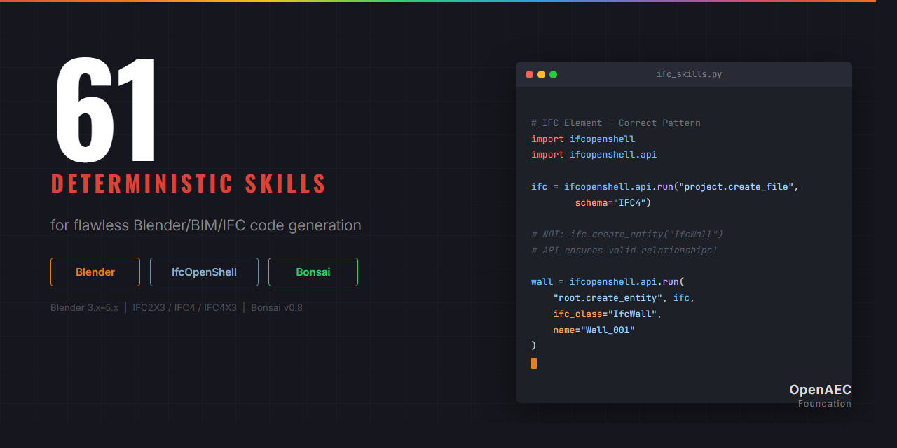

<p align="center">
  
</p>

<p align="center">
  <a href="#quick-start"></a>
  <a href="#technology"></a>
  <a href="#technology"></a>
  <a href="https://github.com/OpenAEC-Foundation/Computational-Design-Day-Delft-March-2026/blob/main/LICENSE"></a>
</p>

<p align="center">
  <strong>Computational Design Day</strong> — Delft, March 2026<br>
  Workshop repository with <strong>61 AI skills</strong> for Blender, Bonsai, IfcOpenShell & BIM workflows.
</p>

---

## What's Included

This workspace comes pre-configured with:
- **61 AI skills** for Blender, Bonsai, IfcOpenShell, and BIM workflows
- **Blender MCP** integration for live Claude-to-Blender interaction
- **Workshop structure** with session folders for participant tools

## Quick Start

1. See [SETUP.md](SETUP.md) for full installation guide
2. Clone, open Blender with MCP addon, start `claude`
3. Start building in `session-1/your-tool-name/` or `session-2/your-tool-name/`

## How to contribute your tool

**Option A: Clone (easiest)**
1. Clone this repository: `git clone https://github.com/OpenAEC-Foundation/Computational-Design-Day-Delft-March-2026.git`
2. Create your tool in the appropriate session folder: `session-1/your-tool-name/`
3. Push directly (if you have access)

**Option B: Fork**
1. Fork this repository
2. Create your tool in the appropriate session folder: `session-1/your-tool-name/`
3. Create a Pull Request

## Structure

```
.claude/skills/          61 AI skills (Blender, Bonsai, IfcOpenShell, BIM)
.mcp.json                Blender MCP server configuration
CLAUDE.md                Workshop instructions for Claude
SETUP.md                 Participant setup guide
session-1/               Morning session tools
session-2/               Afternoon session tools
```

## Technology

| Technology | Version | Skills |
|------------|---------|--------|
| Blender | 3.x / 4.x / 5.x | 26 skills |
| IfcOpenShell | Latest + IFC2X3/IFC4/IFC4X3 | 19 skills |
| Bonsai | Current | 14 skills |
| AEC Cross-tech | - | 2 skills |

Skills source: [Blender-Bonsai-IfcOpenShell-Sverchok Claude Skill Package](https://github.com/OpenAEC-Foundation/Blender-Bonsai-ifcOpenshell-Sverchok-Claude-Skill-Package)

---

*Part of the [OpenAEC Foundation](https://github.com/OpenAEC-Foundation) ecosystem.*
